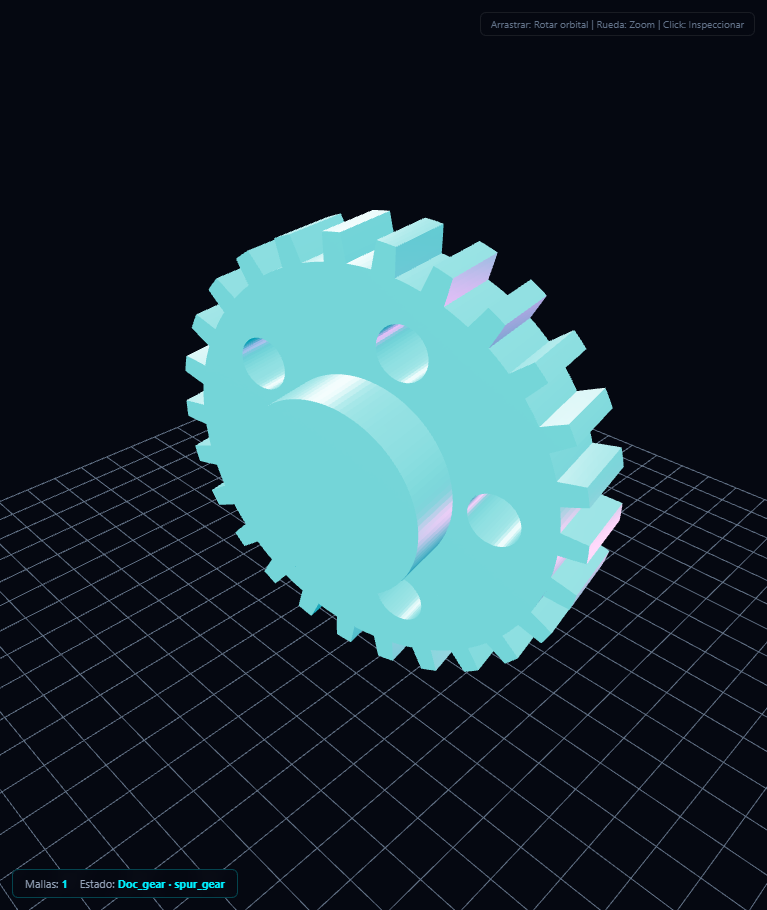
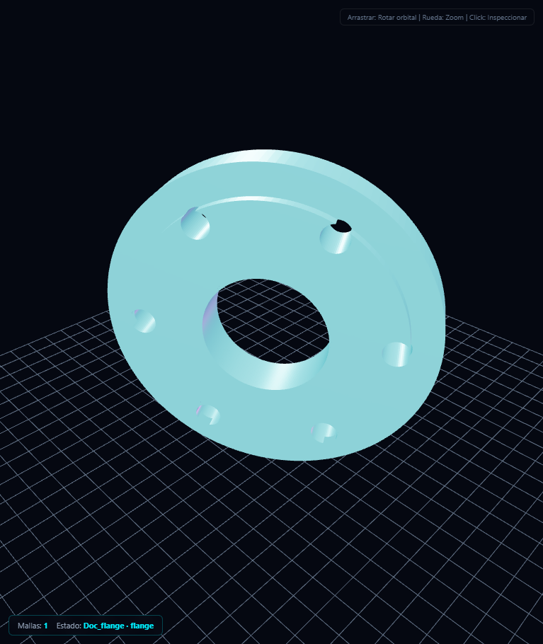
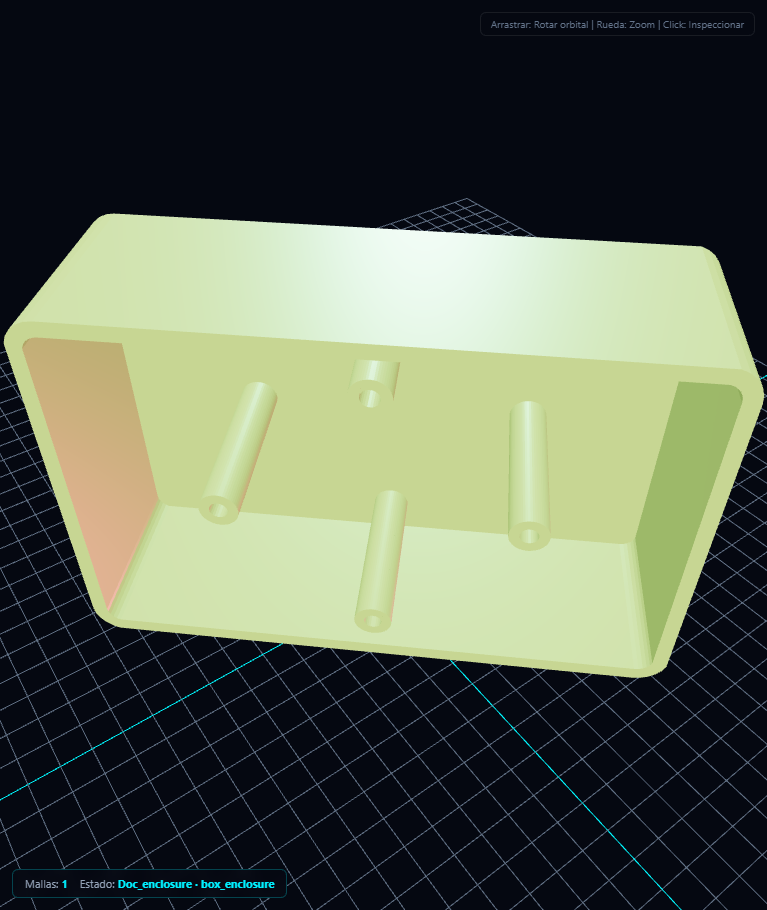

# 🧊 Motor de Diseño 3D y CAD de JEV

Documento técnico del pipeline de modelado 3D paramétrico: qué estaba roto, cómo se
arregló, qué piezas se pueden generar, cómo se exportan y qué repositorios de GitHub
se integraron.

---

## 1. Síntoma reportado

> "No me deja generar el diseño en 3D."

El agente respondía con texto, intentaba escribir JavaScript dentro de Python o
directamente fallaba, y el Viewport 3D se quedaba mostrando el toro de bienvenida.
Las piezas nunca llegaban a generarse.

## 2. Causas raíz encontradas

| # | Causa | Archivo | Efecto |
|---|-------|---------|--------|
| 1 | **El enrutador MoAE no tenía ningún cluster de 3D/CAD.** Ante "diseña un engranaje en 3D" activaba *web_research* y *system_environment*, por lo que **skill_cad_mesh**, **skill_mesh_generator** y el Viewport ni siquiera se enviaban al modelo. | **jev/core/mythos_engine.py** | El LLM no podía invocar la herramienta: improvisaba Python/JS. |
| 2 | **El adaptador de skills marcaba *todos* los parámetros como obligatorios**, incluidos los que tienen valor por defecto. | **jev/skills/manager.py** | Llamadas válidas rechazadas con "ESQUEMA INVÁLIDO: faltan name, params, color...". |
| 3 | **La escena Three.js solo contenía una primitiva aproximada** (un cilindro en lugar del engranaje), sin la malla real. | **jev/tools/custom/skill_cad_mesh.py** | Aunque se generara la pieza, en pantalla aparecía otra cosa. |
| 4 | **El parser del Viewport no sabía leer BufferGeometry** (vértices + índices) ni encuadrar la cámara; además el límite de zoom era 60 unidades, inservible para piezas en milímetros. | **jev/ui/templates/jarvis.html** | Mallas invisibles, recortadas o fuera de cámara. |
| 5 | **No existía herramienta para controlar el Viewport** (render_3d_scene / execute_viewport_script): solo se podía "adivinar" el JS. | **jev/tools/viewport.py** (nuevo) | Sin vía canónica para escenas libres. |
| 6 | **La memoria procedimental empujaba a escribir JavaScript dentro de Python** para cualquier meta 3D. | **jev/core/memory.py**, **jev/core/agent.py**, **jev/core/planner.py** | El plan DAG y las lecciones reforzaban la ruta equivocada. |

## 3. Solución implementada

### 3.1 Enrutador MoAE con expertos 3D

Se añadió el cluster **3d_design** (más **visual_synthesis**, **web_design** y
**engineering_analysis**) y se mejoró el emparejamiento de palabras clave:

- Palabras cortas (3d, cad, stl, obj, gltf) con límites de palabra.
- Si el usuario nombra una herramienta explícitamente, se habilita siempre.
- El cluster 3D expone: **skill_cad_mesh**, **skill_mesh_generator**,
  **render_3d_scene**, **execute_viewport_script**.

### 3.2 Esquema de skills correcto

SkillToolAdapter solo exige los parámetros **sin** valor por defecto:

~~~python
required = [name for name, spec in properties.items()
            if isinstance(spec, dict) and "default" not in spec]
~~~

### 3.3 Kernel CAD real (jev/core/cad_kernel.py)

- **manifold3d** para CSG robusto: extrusión de perfiles, revolución de sólidos,
  unión / diferencia / intersección. De aquí salen los taladros, vaciados,
  chaflanes y aligeramientos.
- **trimesh** para validación de estanqueidad, reparación y exportación
  STL / GLB / OBJ.
- **Fallback NumPy** para piezas sin booleanas si manifold3d no estuviera
  instalado (engranajes, bridas, arandelas, resortes y codos).
- Todos los sólidos se generan en **milímetros** y centrados en el origen
  (Z = eje axial).

### 3.4 Escena con malla real + Viewport preparado

La escena que viaja al frontend incluye BufferGeometry real:

~~~json
{
  "elements": [{
    "type": "mesh",
    "name": "Motor_Pinion",
    "geometry": {
      "type": "BufferGeometry",
      "positions": [x0, y0, z0, x1, "..."],
      "indices": [i0, j0, k0, "..."]
    },
    "material": { "color": "#00f0ff", "metalness": 0.45, "roughness": 0.38, "flatShading": true }
  }],
  "camera": { "radius": 58.5, "theta": 0.785, "phi": 1.05 },
  "grid": { "size": 80, "divisions": 16 },
  "bounds": { "min": [0, 0, 0], "max": [0, 0, 0], "sphere_radius": 22.5 }
}
~~~

El parser del Viewport ahora:

- Construye THREE.BufferGeometry con setAttribute('position') y setIndex
  (Uint16/Uint32 según el número de vértices).
- Calcula normales y usa flatShading para aspecto de pieza mecanizada.
- Encuadra la cámara con la esfera envolvente o usa la cámara enviada.
- Reajusta la rejilla al tamaño de la pieza y recoloca el zoom (0,05 – 10.000 mm).
- Iluminación de estudio (clave blanca + relleno cian + contraluz magenta) y
  tone mapping ACES.

### 3.5 Guardia contra la ruta equivocada

**execute_python** rechaza ahora cualquier código que contenga marcadores de
Three.js (`new THREE.`, `THREE.BufferGeometry`, `THREE.WebGLRenderer`) y devuelve
un mensaje que redirige a **skill_cad_mesh** / **render_3d_scene**. Así el bucle
ReAct no puede volver a "diseñar en 3D" generando JavaScript dentro de Python.

### 3.6 Herramientas nuevas del Viewport

| Herramienta | Uso |
|-------------|-----|
| **render_3d_scene** | Escenas declarativas JSON (primitivas o BufferGeometry), sin escribir JavaScript. |
| **execute_viewport_script** | Animación/transformaciones en JavaScript nativo sobre scene, camera, renderer y dynamicGroup. Rechaza duplicar WebGLRenderer/Scene/PerspectiveCamera. |

---

## 4. Catálogo de piezas

~~~python
skill_cad_mesh(model_type="spur_gear", parameters={"teeth": 24, "pitch_radius": 15,
               "thickness": 5, "bore_radius": 4, "lightening_holes": 5})
~~~

| model_type | Pieza | Parámetros principales |
|------------|-------|------------------------|
| spur_gear | Engranaje recto con cubo y aligeramientos | teeth, pitch_radius, thickness, bore_radius, tooth_height, hub_radius, hub_height, lightening_holes, hole_radius, hole_circle_radius |
| helical_gear | Engranaje helicoidal (extrusión con giro) | teeth, pitch_radius, thickness, bore_radius, helix_angle |
| flange | Brida con cara elevada, cubo y taladros perimetrales | outer_radius, inner_radius, thickness, bolt_count, bolt_circle_radius, bolt_hole_radius, hub_radius, hub_height, raised_face |
| washer | Arandela | outer_radius, inner_radius, thickness |
| hex_nut | Tuerca hexagonal con chaflán | across_flats, thickness, bore_radius, chamfer |
| bolt | Perno de cabeza hexagonal con alojamiento Allen | head_diameter, head_height, shank_diameter, length, socket, socket_size |
| shaft | Eje escalonado con chavetero | diameter, length, keyway, keyway_width, keyway_depth, steps |
| box_enclosure | Carcasa hueca con tapa y postes | width, depth, height, wall_thickness, corner_radius, open_top, lid, standoffs |
| l_bracket | Escuadra en L con taladros | leg_a, leg_b, width, thickness, hole_diameter, holes_per_leg |
| pulley | Polea con garganta trapezoidal | outer_radius, groove_depth, width, bore_radius, hub_radius, hub_width |
| bearing | Rodamiento (pistas + bolas) | outer_radius, inner_radius, width, ball_count, ball_radius |
| gear_rack | Cremallera | teeth, module, width, height, hole_diameter |
| plate | Placa con taladros | width, depth, thickness, corner_radius, hole_count, hole_diameter, hole_margin |
| pipe_elbow | Codo de tubería (barrido con tapas) | radius, bend_radius, angle_deg, segments |
| helical_spring | Resorte helicoidal | coil_radius, wire_radius, turns, pitch, segments |
| box / cylinder | Bloque y cilindro/tubo | dimensiones básicas |

La calidad de teselado se controla con **quality="low" | "medium" | "high"**.

## 5. Exportaciones

Cada ejecución escribe en **workspace/cad_models/**:

| Formato | Uso |
|---------|-----|
| .scene.json | Escena Three.js reproducible (malla real + cámara + bounds). |
| .OBJ | Intercambio CAD/CAM, Blender, MeshLab. |
| .STL | Impresión 3D (binario, estanco). |
| .GLB | glTF binario: visores web, Blender, motores de juego. |
| .GLTF | glTF 2.0 con buffer Base64 (índices uint16/uint32 automáticos). |

## 6. Repositorios de GitHub integrados

Búsqueda realizada con la API de GitHub y clonado en **repos/** (profundidad 1):

| Repositorio | ★ | Rol en JEV | Estado |
|-------------|---|------------|--------|
| mikedh/trimesh | ~3.4k | Validación de estanqueidad, reparación y exportación STL/GLB/OBJ | **Instalado** (trimesh>=4.0) y usado por el kernel |
| elalish/manifold | ~3k | CSG robusto (booleanas, vaciados, taladros) vía manifold3d | **Instalado** (manifold3d>=3.0) y usado por el kernel |
| CadQuery/cadquery | ~6k | CAD paramétrico B-Rep con OpenCASCADE (STEP/IGES) | Clonado; backend **opcional** (requiere cadquery-ocp) |
| gumyr/build123d | ~3.5k | API de CAD moderna sobre CadQuery | Referencia; backend opcional |
| earthtojake/text-to-cad | ~23.7k | cadgen: modelos como Python → STEP/GLB/STL/3MF + checks DFM | Clonado; pipeline opcional (pip install cadgen) |
| fogleman/sdf | ~2k | Diseño orgánico por funciones de distancia (SDF → STL) | Clonado; requiere scikit-image, meshio, matplotlib |
| flowful-ai/cad-skill | ~700 | Skill de Claude para piezas imprimibles con CadQuery | Clonado como referencia de flujo de trabajo |

### Instalar los backends opcionales

~~~powershell
# Núcleo (ya instalado por este parche)
..venvScriptspython.exe -m pip install manifold3d trimesh

# CAD B-Rep con STEP/IGES (pesado, ~600 MB con OCP)
..venvScriptspython.exe -m pip install cadquery
..venvScriptspython.exe -m pip install build123d

# Text-to-CAD con checks de fabricación (arrastra build123d y OCP)
..venvScriptspython.exe -m pip install cadgen

# Diseño orgánico por SDF
..venvScriptspython.exe -m pip install scikit-image meshio matplotlib
~~~

El kernel detecta automáticamente manifold3d y trimesh; el resto son extensiones
que no rompen nada si no están instaladas.

## 7. Verificación

~~~powershell
# Suite específica del pipeline 3D (23 pruebas)
..venvScriptspython.exe -m unittest tests.test_3d_cad_pipeline -v

# Regresión de la suite existente
..venvScriptspython.exe -m unittest tests.test_modular_expansion_v26 tests.test_tools

# Genera las piezas de demostración en workspace/cad_models
..venvScriptspython.exe scriptsgenerate_cad_showcase.py

# Renderiza capturas reales del Viewport con Chromium headless
..venvScriptspython.exe scriptserify_3d_viewport.py
~~~

Capturas generadas por la verificación:

## 8. Cómo pedirlo al agente

Ejemplos que ahora se resuelven por la ruta correcta:

- "Genera un diseño 3D de un engranaje de 24 dientes y guárdalo en workspace."
- "Diseña una brida de 6 tornillos para una tubería de 24 mm."
- "Hazme una carcasa de 95×62×30 mm con tapa para una placa Arduino."
- "Crea una polea de 56 mm de diámetro con garganta trapezoidal."
- "Modela un rodamiento 6203 y expórtalo a STL y GLB."

El agente debe invocar **skill_cad_mesh** (o **render_3d_scene** para escenas libres);
la pieza se proyecta automáticamente en el Viewport y los archivos quedan en
**workspace/cad_models/**.
