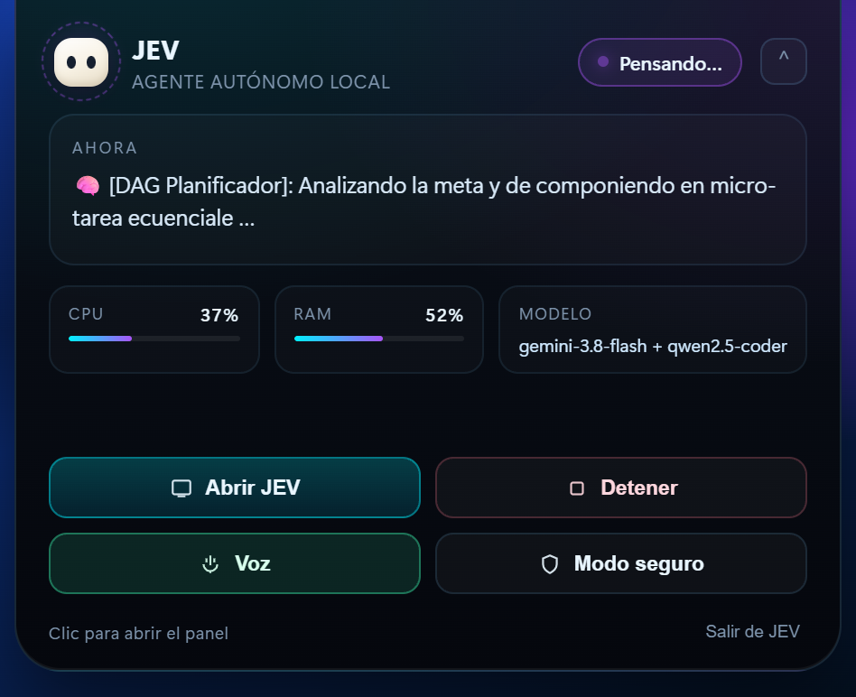
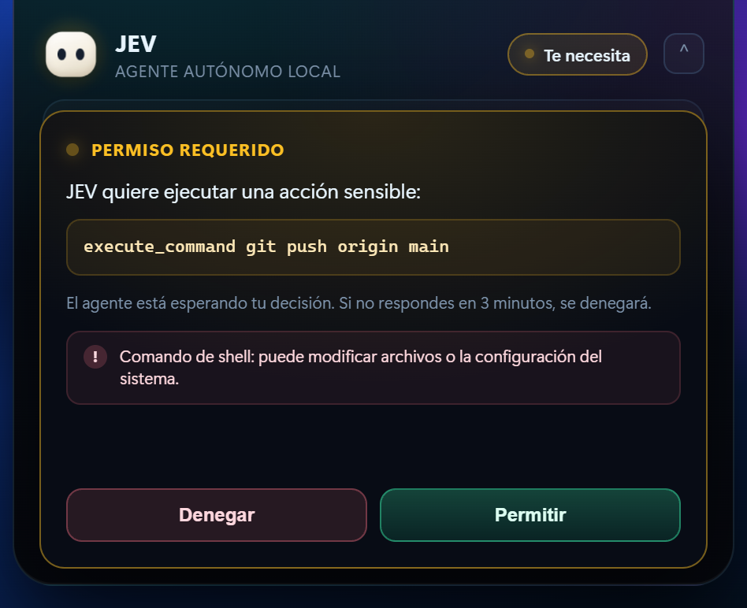

# 🖥️ La Isla de JEV: compañero flotante de escritorio

JEV ya no es "una carpeta con un .bat": vive en el borde superior de la pantalla
como una isla flotante (estilo Coucou), siempre visible y por encima del resto de
ventanas. Desde ella se abre la ventana JARVIS completa.

El patrón está tomado de [Louis-CFM/coucou](https://github.com/Louis-CFM/coucou):

| Concepto de Coucou | Equivalente en JEV |
|--------------------|--------------------|
| Isla/notch siempre visible | **island.html** en ventana sin marco, transparente y *on top* |
| Motor Mochi (Canvas 2D) | Superellipsoid exacto ($r(y)=(1-\|y\|^{2.7})^{1/2.7}$), sombreado 3 capas, ojos 3D y colorete |
| Cuadrícula 2x2 Mini-Mochis | 4 Mini-Mochis (`#2DD4BF`, `#F59E0B`, `#8B5CF6`, `#EF4444`) con ojos animados |
| Tarjeta de Permisos | Vista idéntica con Mochi con insignia `!`, wash ámbar, código mono, `Deny [N]`, `Allow [Y]`, `Always` |
| Chat integrado en la isla | Dock con input `bonjour Mochi`, botón circular `↑` y burbujas de diálogo |
| Séquence de dépôt | Zona drag & drop donde Mochi abre la boca y procesa archivos o imágenes |
| Entrada .desktop / instalador NSIS | Acceso directo .lnk + install_desktop_shortcut.ps1 |
| Terminal=false | pythonw.exe + jev_launcher.py (sin consola) |

## 1. Cómo se usa

1. Doble clic en el acceso directo **JEV - Jarvis AI** del escritorio.
2. Aparece la píldora arriba en el centro. Clic en ella para desplegar el panel.
3. **Abrir JEV** muestra la ventana completa (que arranca oculta).
4. **Salir de JEV** termina el proceso y cierra todo.

La isla es una ventana **sin marco, transparente, siempre encima y sin entrada en
la barra de tareas**. Se ancla al centro del borde superior y se redimensiona
entre dos tamaños: píldora (232×66) y panel (474×386).

## 2. El panel

- **Actividad**: último pensamiento del agente o herramienta en ejecución.
- **CPU / RAM**: telemetría en vivo.
- **Modelo**: pensador + ejecutor configurados.
- **Abrir JEV**: muestra y enfoca la ventana completa.
- **Detener**: aborta la tarea en curso.
- **Voz**: activa/desactiva la síntesis de voz.
- **Modo seguro**: pide aprobación antes de acciones sensibles.

### Estados de la mascota

| Estado | Aspecto |
|--------|---------|
| idle | Ojos normales, parpadeo suave, halo cian |
| thinking | Halo violeta pulsante y órbita girando |
| tool | Órbita verde rápida y chip con la herramienta |
| speaking | Boca animada, halo ámbar |
| approval | Halo ámbar pulsante y tarjeta de permiso |

Los ojos siguen ligeramente al cursor dentro de la isla.

## 3. Modo seguro y aprobaciones

El botón **Modo seguro** activa una puerta de aprobación para las acciones
sensibles del agente: **execute_command**, **execute_python**, **write_file**,
**patch_file**, **skill_claude_code** y **skill_sdlc_senior**.

Cuando el agente intenta una de ellas:

1. El hilo del agente se **bloquea** (no se pierde el trabajo).
2. La isla se expande sola y muestra la tarjeta **Permiso requerido** con el
   comando exacto y una nota de riesgo.
3. **Permitir** (o **Y** / **Enter**) continúa la ejecución.
4. **Denegar** (o **N** / **Esc**) cancela esa acción; el agente recibe el aviso y
   debe buscar una alternativa.
5. Si no respondes en **3 minutos**, se deniega automáticamente.

El modo seguro está **desactivado por defecto** y no afecta al modo clásico
**app.py**, donde el agente ejecuta como siempre.

## 4. Archivos implicados

| Archivo | Función |
|---------|---------|
| **jev_desktop.py** | Punto de entrada: crea la isla + la ventana JARVIS oculta. |
| **jev/ui/island.py** | API Python de la isla: estado, tamaño, ventana, aprobaciones, salir. |
| **jev/ui/templates/island.html** | Interfaz: mascota, panel, tarjeta de permiso, animaciones. |
| **app.py** | JarvisBridge: actividad, snapshot de estado y puerta de aprobación. |
| **jev/core/agent.py** | Respeta el veto del usuario (no ejecuta lo denegado). |
| **jev_launcher.py** | Arranque silencioso; por defecto isla, con --classic ventana completa. |
| **launch_jev.vbs** | Lanzador alternativo sin consola (el acceso directo usa pythonw directamente). |
| **crear_acceso_directo.bat** | Crea el acceso directo del escritorio. |
| **iniciar_isla.bat** | Arranca la isla sin pasar por el acceso directo. |
| **assets/jev.ico** | Icono de la aplicación y del acceso directo. |

## 5. Modo clásico

~~~powershell
# Ventana completa de siempre
.\iniciar_jarvis.bat

# O el lanzador en modo clásico
.\.venv\Scripts\python.exe jev_launcher.py --classic

# O directamente
.\.venv\Scripts\python.exe app.py
~~~

## 6. Cómo funciona el arranque

~~~text
[doble clic en el .lnk del escritorio]
        │
        ▼
pythonw.exe jev_launcher.py            (sin consola)
        │  resuelve la carpeta del proyecto
        ▼
jev_launcher.py
        │  log en data\logs\jev_launcher.log
        │  mutex: una sola instancia
        ▼
jev_desktop.main()
        ├── ventana JARVIS completa (oculta hasta "Abrir JEV")
        └── isla flotante (frameless, transparente, on top)
~~~

## 7. Diagnóstico

| Síntoma | Qué revisar |
|---------|-------------|
| No aparece la isla | **data\logs\jev_launcher.log** (errores de arranque). |
| "JEV ya está abierto" | Hay otra instancia; búscala en la barra de tareas. |
| La isla se ve como un rectángulo | La transparencia depende de WebView2; actualízalo desde Windows Update. Como diagnóstico, arranca con la variable de entorno **JEV_ISLAND_OPAQUE=1** para forzar fondo sólido. |
| No aparece en la barra de tareas | Es intencionado: la isla se oculta de la taskbar. |
| Moví la carpeta del proyecto | Vuelve a ejecutar **crear_acceso_directo.bat**. |
| Quiero la ventana clásica | Usa **iniciar_jarvis.bat** o **jev_launcher.py --classic**. |

## 8. Nota sobre Coucou

Coucou es una app nativa (Swift/Tauri); JEV es Python + PyWebView. No se copia su
código: se replica su **contrato de integración** (isla flotante, mascota, panel
desplegable, aprobaciones y entrada de escritorio sin consola) adaptado a
PyWebView y a Windows.
